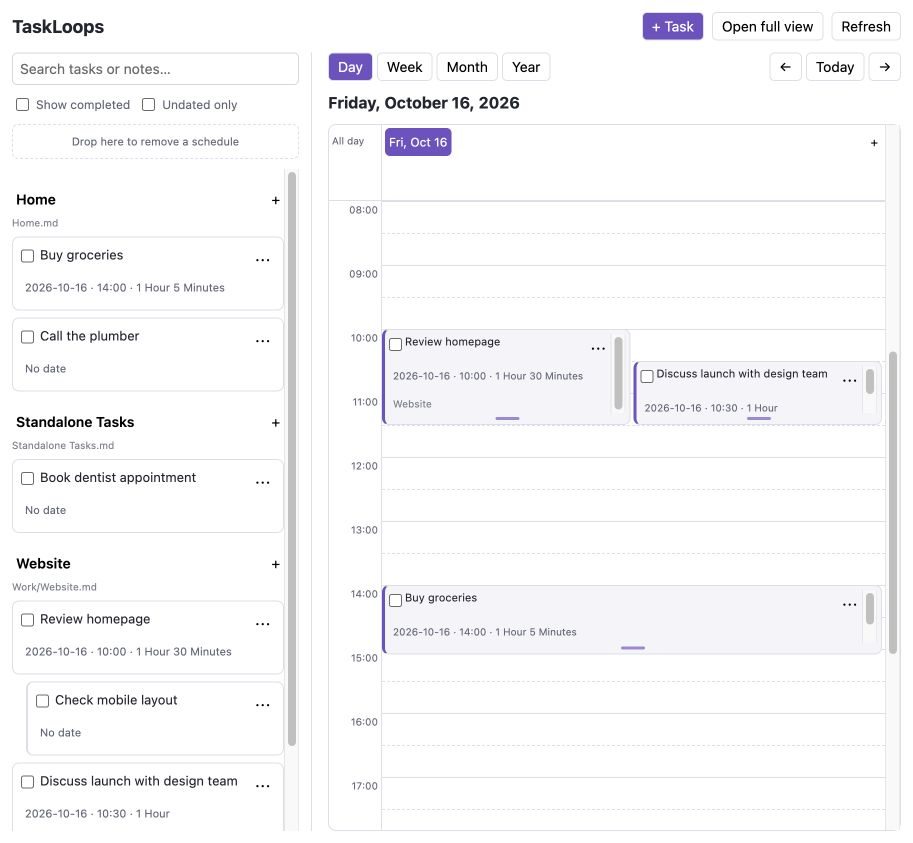
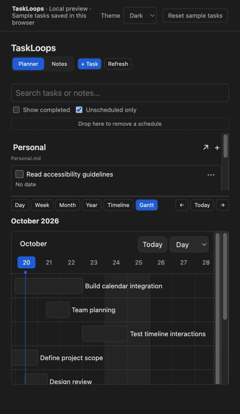
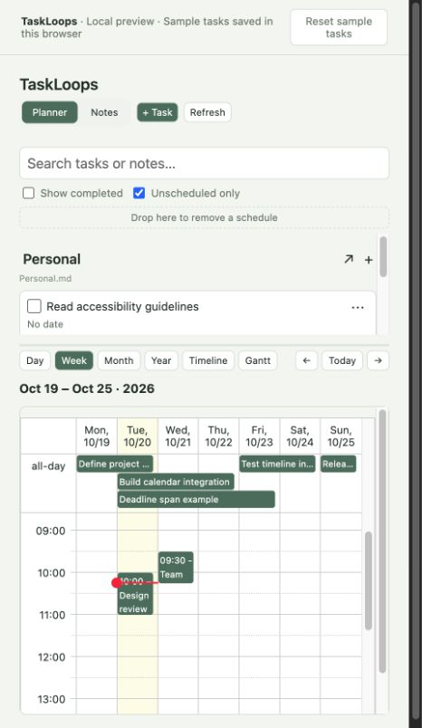
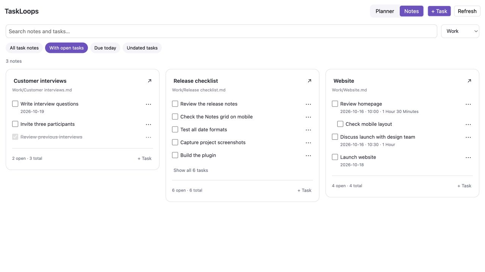
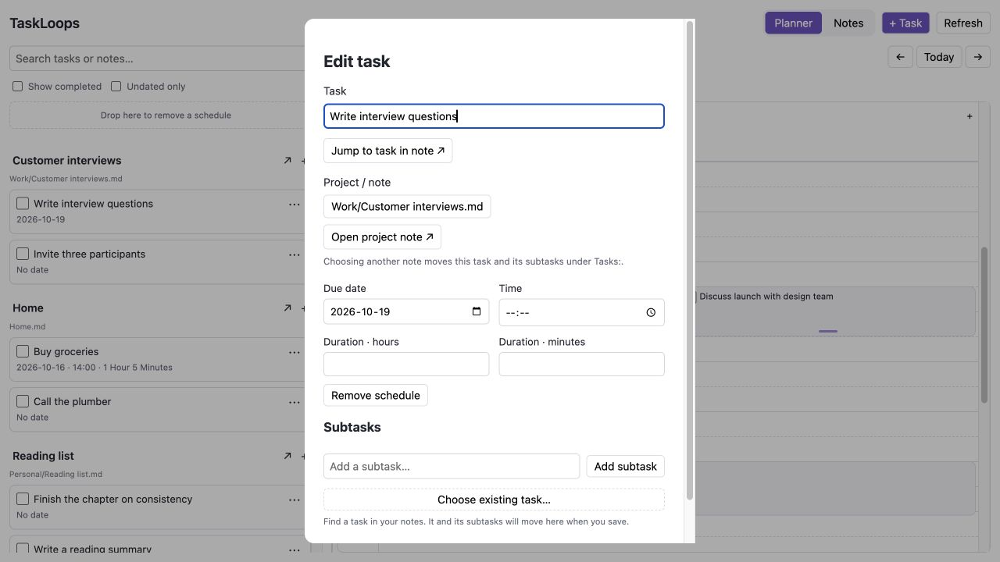
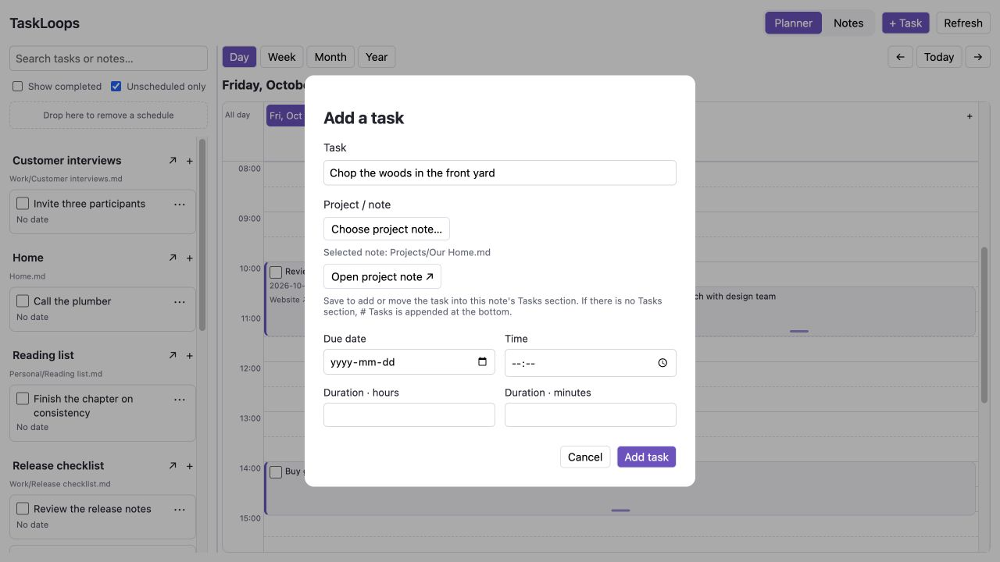
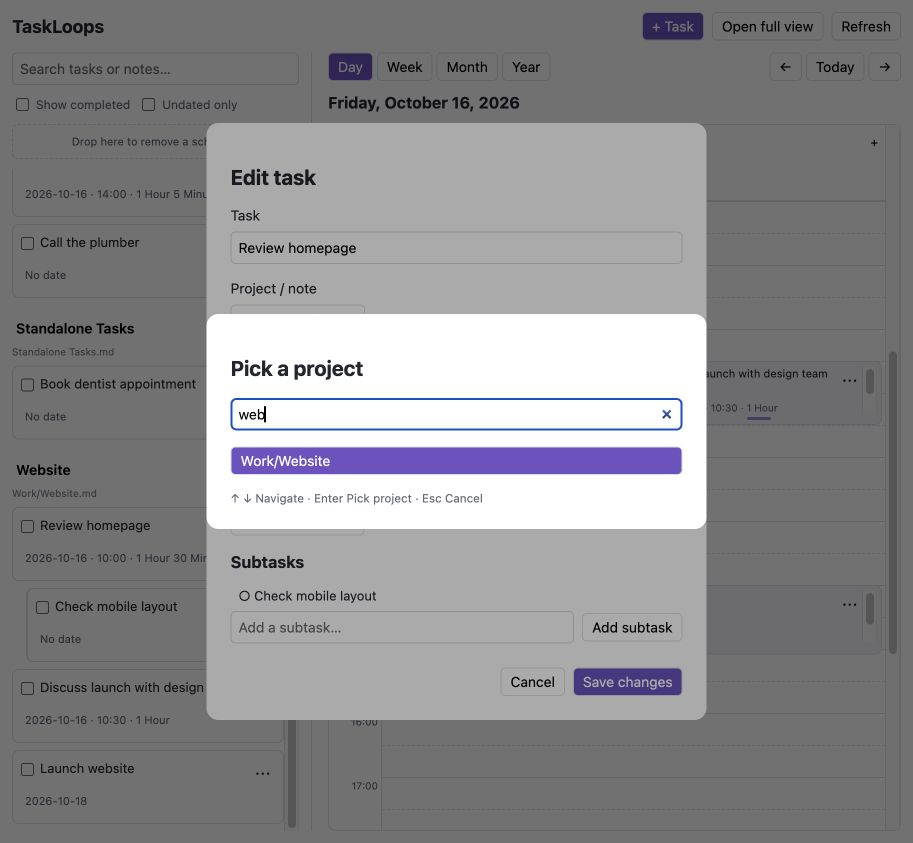
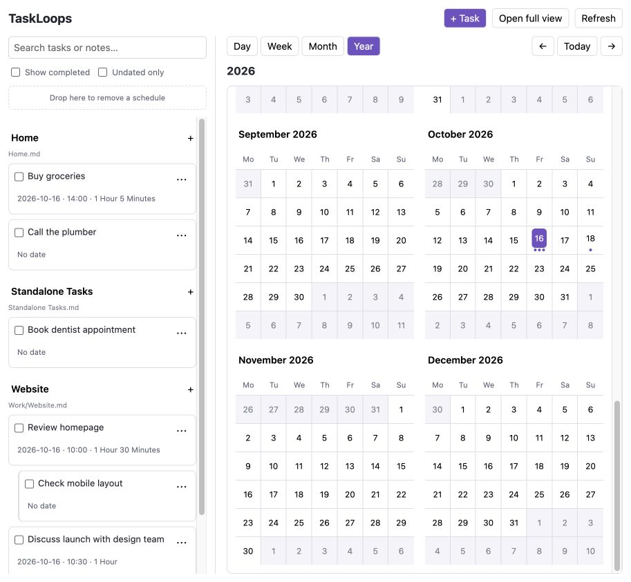
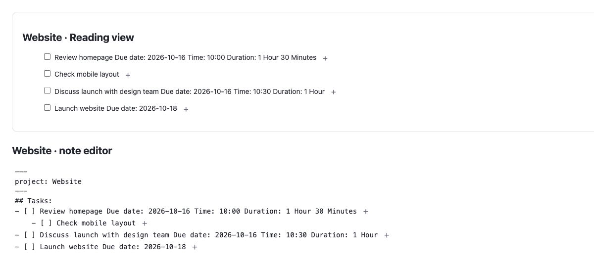
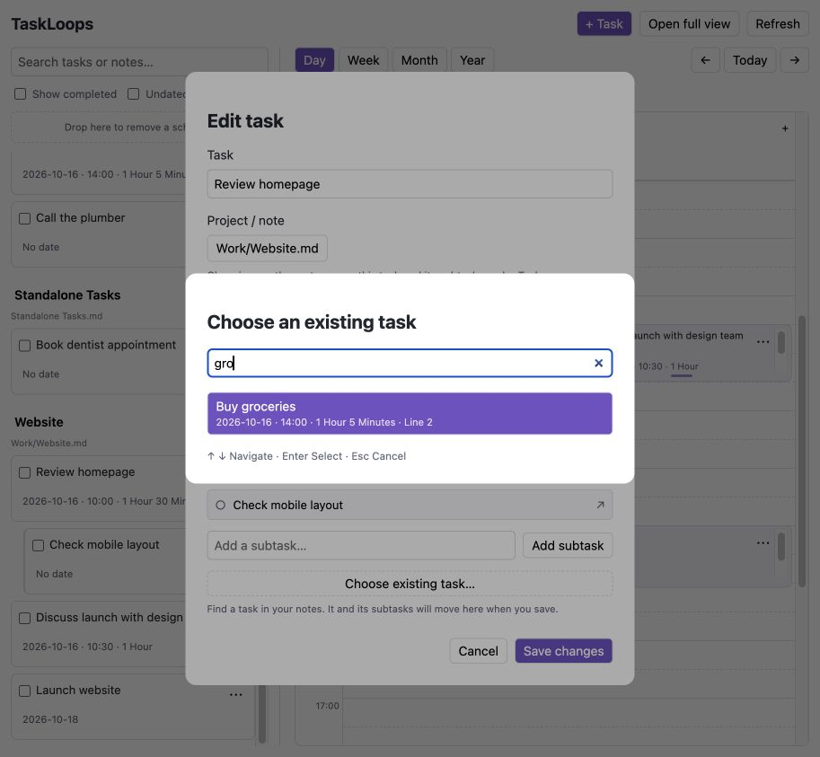

# TaskLoops

[](https://obsidian.md/plugins?id=taskloops)
[](LICENSE)

Turn the Markdown checkboxes in your Obsidian vault into a calendar you can plan
with. TaskLoops gathers tasks from your notes, groups them by note name, and
lets you schedule, resize and edit them without managing note properties.



- Open **Today** for a mobile daily agenda with clear time sections and direct task actions.
- Plan in **Day, Week, Month and Year** views, plus a resource **Timeline** and **Gantt**.
- Set a **Deadline** to stretch a task from its due date through its last day.
  Multi-day tasks appear in Calendar’s all-day row, even when they have a time.
- Switch to **Notes**, a searchable task grid grouped by source note.
- Drag tasks to a date or time in **five-minute intervals** and resize durations.
- Click a task to edit its wording, schedule, project note and subtasks.
- Make a task **repeat** daily, weekly, monthly or yearly, on chosen weekdays,
  days of the month or months. Completing it adds the next occurrence.
- Pick projects with **Obsidian's native fuzzy note search**.
- Open a source note in a **new tab** using the arrow beside its sidebar heading
  or its name on a calendar task. The note opens at the task's line.
- Keep standalone tasks in one configurable note and project tasks under a `Tasks` heading.


## Daily notes

In **Settings → TaskLoops → Tasks → Standalone task storage**, choose
**Standalone tasks note** or **Daily note (core plugin)**. The first uses the
configured standalone note, creating it if needed. The second requires the core
Daily notes plugin and defaults new standalone tasks to the scheduled day’s
note, or today for unscheduled tasks. Saving asks core Daily Notes to open or
create the daily note with its own folder, filename, and template settings,
then inserts the task. Existing daily-note content is preserved.

Tasks added to a specific project note keep that destination. The task dialog
also lets you override the destination and choose a different daily-note date.
Changing this setting does not move previously saved tasks.

Open **TaskLoops: Open daily note calendar** from the command palette or use the
**Daily note calendar** ribbon icon. This is an independent sidebar tab, separate
from the main TaskLoops task planner. Click a date to open or create its daily
note. Dots mark dates with an existing daily note; month arrows and **Today**
change the calendar’s displayed month.

**Settings → TaskLoops → Daily note calendar** controls its first weekday,
ISO week numbers, weekend shading, and existing-note dots independently of the
main task planner. Changes apply immediately to an open daily-note calendar.

## Screenshots

The dark Gantt screenshot shows the 0.5.1 preview. The deadline screenshot shows
the 0.5.0 browser preview with sample tasks.
Other screenshots show the earlier interface; calendar controls and task dialogs
have changed in 0.5.0. Obsidian supplies its theme, native note picker and vault access.

### Theme-aware Gantt

Labels, weekend shading, controls and task bars follow the active Obsidian palette.
This browser preview uses the Dark palette; Light and a custom Plum palette are
also available in the preview's Theme picker.



### Multi-day deadlines

This task runs from October 20 through October 23. Its optional time and effort
remain available in the editor while its date span sits above the hourly grid.



### Browse your task notes

Switch to **Notes** for a searchable grid of task cards grouped by source note.
Filter by folder or task status, edit tasks, and add new tasks to a project note.



### Plan your day

Tasks stay grouped by source note while the calendar shows their start times,
durations and overlaps. Drag to schedule and use the bottom handle to resize.


### Edit a task and its subtasks

Open a task to change its text or schedule, pick a project note, and add subtasks.
**View in note** opens the source at the task's line in a new tab.
**Open note** opens the currently selected destination in a new tab.
Navigation does not save or discard the dialog's unsaved edits. New destinations
must be saved before they can be opened. The Add task dialog also has the
project-note link.



### Search your project notes

Use **Change note…** to search existing notes. The selected note path is
shown separately; **Add task** writes into that note. When it has no Tasks
section, TaskLoops appends the following at the end of the existing content:

```markdown
# Tasks
- [ ] Your new task
```

Existing Tasks headings (including older `## Tasks:` sections) are reused without
duplicating them. Choosing a note alone does not modify it.



Type a note name or folder path to find the destination for a task. In Obsidian,
this uses the native fuzzy note picker; the browser preview demonstrates the flow.



### See tasks across the year

Dots mark dates containing tasks. Select a date to open its daily timeline.



## The planner

The task sidebar and calendar appear together. In a main tab they sit side by
side; in a narrow Obsidian sidebar the task list sits above the calendar. Use
the command palette's **Open planner in a main tab** command for more room.
Drag the divider between the task list and calendar to resize them. At narrow
widths, drag it vertically instead. Panel sizes are remembered independently
for desktop and stacked layouts. Focus the divider and use arrow keys (Shift
for larger steps), Home/End for its limits, or double-click to reset.

- **Day:** a 24-hour timeline with five-minute drag-and-drop scheduling.
- **Week:** seven daily timelines, with simultaneous tasks shown alongside each other.
- **Month:** tasks inside day cells, with multi-day tasks spanning dates.
- **Year:** twelve mini calendars with dots beneath dates containing tasks.
  Up to three dots are shown per date; its accessible label gives the full task
  count. Click a month heading to open that month, or a day to open its timeline.

- **Timeline:** resource rows grouped by source note, with a horizontal time axis.
- **Gantt:** task bars with date-span resizing, navigation and selectable time scales.

Arrows navigate by the selected scale. **Today** returns to the current day.
Weeks begin on Monday by default; settings also offer Sunday and Saturday. Dates and times are local wall-clock values.

## Tasks grouped by note

All Markdown checkbox tasks are discovered automatically, using Obsidian's
metadata cache so frontmatter and fenced code examples do not become tasks.
The sidebar groups them by note name, alphabetically, and preserves source-line
order within each note. Full paths distinguish notes with the same name.

Search by task text or note path. **Unscheduled** is selected by default: adding a due date removes a task
from the sidebar while keeping it on the calendar. Clear the filter to include
scheduled tasks in the sidebar again. **Show completed** includes completed
tasks in both places. Completed tasks are hidden by default.

Click a note heading or a calendar card's note name to open the source. Click a
task title or the card itself to open its editor. You can also edit task wording
directly in the source note.

## Notes view

Switch between **Planner** and **Notes** at the top of TaskLoops. Notes shows a
responsive grid of notes containing Markdown tasks, sorted by note name. Search
note paths or task text, choose a folder, and filter by open tasks, tasks due
today, or undated tasks. Filters select matching notes; their other tasks remain
visible for context. **All task notes** also includes notes with only completed
tasks. Notes without Markdown tasks are not included.

Click a task to edit it, or **+ Task** on a note card to add to that note's
`Tasks:` section. The arrow or note title opens the source in a new tab. Cards
preview a configurable number of tasks; **Show all** expands longer lists.

On narrow screens the grid becomes one column and the Planner task list stacks
above the calendar. Week and month calendars scroll horizontally to keep dates
readable. On mobile, tap a task to schedule it through the editor. Short timed
events show a compact title; click or tap to see scheduling details and edit the task.
Use the task editor when a narrow screen makes dragging difficult.

## Settings and vault access

Settings include the default view for new panels, tasks per note card (3, 5 or
10), comfortable/compact note cards, calendar scale for new panels, completed-task
visibility for new Planner panels, and the following scheduling preferences:

| Setting | Choices |
| --- | --- |
| Date format | 15 formats with examples (listed below) |
| Time display | 24-hour or 12-hour with AM/PM |
| Week starts on | Monday, Sunday or Saturday |
| Timeline opening hour | Any hour from 00:00 to 23:00; the whole day stays available |
| Default task duration | 5, 15, 30, 45, 60, 90 or 120 minutes for new timed schedules |

The standalone note destination and optional **Task scan folder** are also
configurable. A scan folder includes its subfolders and limits task-content reads;
leave it blank for all Markdown notes. Tasks outside the scope remain untouched
in their source notes. Existing settings and legacy data survive upgrades.

The settings use Obsidian's searchable definitions on 1.13+ and keep the settings
page available on 1.7.2+. Both versions use the same setting definitions and
save through TaskLoops' existing data wrapper.

TaskLoops processes notes locally and does not upload their contents. The vault
enumeration disclosure is expected: discovery and native project search list
Markdown file paths. A folder scope limits content reads, not permission to list
paths. It does not sandbox the plugin. **Malware scan not available** is a status
from the external review service; implementing settings search does not provide
or certify a malware scan.

## Schedule from a note

A small calendar-plus button appears after checkbox tasks in the note editor
(including Live Preview) and Reading view. Click or tap it to open the existing
task editor for dates, time, duration, projects and subtasks. The button is a
visual control: it is never written into your Markdown or note properties.
The editor saves pending note edits before opening the task, and verifies the
source row again before offering edits. Code examples and frontmatter are
excluded. In Reading view, custom renderers or embeds without a reliable task
mapping may omit the button rather than point it at a different task.



On mobile, TaskLoops opens in a main workspace tab instead of the right sidebar.
An existing mobile sidebar instance is moved to the main area when restored or
opened. A week-based planner initially opens in Day view on mobile; Week remains
available from the calendar scale controls. Desktop opening keeps its existing
sidebar/main-tab options.

## Can’t schedule now

Select **Can’t schedule → + Add task** and choose New task or Existing task.
Enter a short reason and select **Save reason**. Existing tasks stay in their
source note; any current schedule is removed. Cancel makes no changes.
The reason is an indented continuation beneath the checkbox, like Shift+Enter:

```markdown
- [ ] Book the supplier visit
    Can't schedule now: Waiting for confirmed availability
```

The task card offers **Today**, **Tomorrow**, **Next week** and **Choose date…**.
These are date choices, not claims that your calendar is free. Scheduling through
these buttons, the editor, drag/drop or Gantt resolves the reason in the same
note write and retains the history:

```markdown
- [ ] Book the supplier visit - Due date: 2026-10-23
    Can't schedule now: Waiting for confirmed availability — Scheduled on 2026-10-20 for 2026-10-23
```

The task then leaves Can’t schedule now. Deferring it again preserves previous
resolved reasons. Completing it also removes it from that section. Ordinary
unscheduled tasks and waiting tasks have separate filters; All includes both.

## Dates, times and durations

Click a task, its schedule details or **⋯** to open the task editor and set its
optional due date, start time, and duration in whole hours and minutes. For example:

```markdown
- [ ] Buy groceries - Due date: 2026-10-16 Time: 14:00 Duration: 1 Hour 5 Minutes
```

Date-only tasks are supported:

```markdown
- [ ] Renew insurance - Due date: 2026-10-16
```

The originally supported bare ISO date also works:

```markdown
- [ ] Buy groceries 2026-10-16
```

New schedules use ` - ` between the task wording and its details. You can also
type `- [ ] Task - date: 2026-10-19` manually; it is discovered on the calendar
without opening the task editor. `date:` and `Due date:` are case-insensitive.
Only Markdown checkbox tasks are gathered; ordinary `- Text` bullets are not.
Undated checkbox tasks stay in the sidebar. Older schedules without the separator
remain readable and are converted only when you explicitly edit their schedule.

Scheduling fields must be at the end of a task, before an optional Obsidian block
id. A time or duration requires a date. A task with no time appears in the
all-day row. Timed tasks occupy their duration; a task with no duration uses a
30-minute fallback block. Newly scheduled timed tasks use the default duration
chosen in settings, saved explicitly to the task. Events extending past midnight continue on the following day.

**Settings → TaskLoops → Date format** offers 15 choices:

- Year first: `YYYY-MM-DD` (default), `YYYY/MM/DD`, `YYYY.MM.DD`, `YYYYMMDD`.
- Day first: `DD/MM/YYYY`, `DD.MM.YYYY`, `DD-MM-YYYY`, `D/M/YYYY`, `D.M.YYYY`, `D-M-YYYY`.
- English month names: `D MMM YYYY`, `DD MMM YYYY`, `D MMMM YYYY`, `MMM D, YYYY`, `MMMM D, YYYY`.

Each option shows an example in settings. The choice applies to task dates in
the interface and future scheduling writes. All supported formats remain
readable after changing settings; existing notes are never bulk-rewritten.
Numeric day-first dates always keep their meaning: `03/04/2026` is April 3.
Use English month names for month-first dates without ambiguity. Invalid dates
remain untouched as part of the task wording. Time display can use AM/PM while
Markdown always stores `HH:mm` so notes stay portable.

## Drag to plan

- Drag a sidebar task onto a day to assign that date.
- Drop anywhere on a Day or Week timeline to set its start time in five-minute
  intervals. A marker shows the exact time while dragging.
- Drag a calendar task to another day or time to reschedule it. Duration is preserved.
- Drop on the all-day row to clear the start time while keeping the date and duration.
- Drop on **Drop here to remove a schedule** in the sidebar to clear date, time and duration.

Day cells in Month and Year preserve an existing start time. Every scheduling
action is also available through the task editor for keyboard and touch use.

## Resize a task or date span

In Day and Week, resize the bottom edge of a timed event to change its duration.
In Gantt, resize a bar's edges. For tasks with a deadline, resizing the date span
updates the deadline while keeping effort duration separate. Moving a deadline
span shifts both dates together. Multi-day spans stay in the all-day row above
the hourly grid. The task editor also accepts exact time and duration values.

Completed tasks cannot be rescheduled. To edit dates using a keyboard or on
mobile, open the task editor and select **Save changes**.

## Edit tasks and add subtasks

Click a task title, its card, schedule details or **⋯** to open **Edit task**.
On a wide screen the editor docks on the right and the planner stays visible.
On a phone or a narrow window it opens as a full page. Close it with **×**,
**Cancel** or Escape. Clicking another task switches the open editor.
The editor lets you change its wording, choose its project note, edit its
schedule, and add subtasks. Changes are applied only when you select
**Save changes**; **Cancel** discards the draft. **Delete task** immediately removes only that
task’s checkbox line from its source note; subtasks and other note content remain. **Clear schedule** clears the
form's scheduling fields and is applied when you save.

Existing direct subtasks are clickable rows in the editor: select one to open
its own editor, then return to the parent. Add new ones with the subtask field
and **Add subtask** or Enter. An unfinished entry is also included when
you save. New subtasks are ordinary indented Markdown checkboxes beneath their
parent, so they work in the source note and appear indented in the sidebar.
Each subtask has its own completion and optional schedule; completing a parent
does not complete its subtasks.

### Choose an existing task as a subtask

Use **Choose existing task…** in the parent's editor to browse tasks already in
your notes:

1. Search for a note that contains available open tasks.
2. Search its task list; each result shows its current schedule and source line.
3. Select one or more tasks. The pending rows show where they come from and can
   be removed before saving.
4. For a **standalone parent**, its destination changes to the selected tasks’
   note. Select tasks from that one note, then **Save changes**: the parent moves
   there and the selected tasks stay in their original note beneath it.
   For a parent already in a project note, selected tasks are placed beneath
   it at its chosen destination. Schedules, formatting and existing subtrees
   are preserved; successful saves keep one copy.

Selecting a task makes no note changes until you save. Cancel discards the
selection. Existing descendants, ancestors and overlapping selections are
excluded to prevent loops. Open an added subtask's editor by clicking its row.



Choosing another **Project / note** moves the task and its indented subtree to
that note's `Tasks:` section. Formatting, block ids and existing subtask content
are preserved; unrelated sections and note properties stay in place. Moving a
task into a different note updates its sidebar group automatically.

## Projects are notes

Use **+ Task**, a note group's **+**, a calendar day's **+**, or an empty timeline
slot to create a task. The task form lets you **pick a project / note** from all
Markdown notes in the vault. The picker uses Obsidian’s native fuzzy search:
type part of a note name or folder path, use the arrow keys to navigate, and
press Enter to select. Escape cancels. No project properties or special project
tasks are required.

New tasks go under a `Tasks:` heading in the note you pick:

```markdown
## Tasks:
- [ ] Review homepage - Due date: 2026-10-16 Time: 10:00 Duration: 1 Hour 30 Minutes
```

An existing heading is reused; otherwise `## Tasks:` is appended at the end.
Insertion stops before the next heading of the same or higher level. Headings
inside code fences and frontmatter are ignored. Existing tasks elsewhere in the
note stay where they are.

Choose **Standalone tasks** for tasks without a project. These go in
`Standalone Tasks.md`, created on first use. Its path is configurable in
settings. Changing that path changes the destination for future tasks; it does
not move earlier tasks.

## What changes in your notes

TaskLoops makes these deliberate edits:

1. Completing a task changes its checkbox from `[ ]` to `[x]`. Reopen it in the source note.
2. Scheduling adds, updates or clears the scheduling suffix on that task line.
3. Adding a task inserts a new checkbox under `Tasks:` in the selected note,
   creating that heading or the standalone note when needed.
4. Saving edited wording changes that task's text while preserving its checkbox,
   Markdown list prefix and block id. New subtasks are added as indented checkboxes.
5. Choosing another project in the editor moves that task's subtree into the
   destination note's `Tasks:` section.

Frontmatter, note properties and unrelated lines are preserved. Task wording
and task locations change only when you explicitly edit or move a task.
Scheduling and completion re-find the original line before writing; if it moved, only a unique exact match is accepted. An edited or
ambiguous task is left untouched and a notice asks you to refresh.

Moves between notes cannot be atomic. TaskLoops writes the destination first,
then removes the original only if the source subtree still matches. On failure
it rolls back its destination write when safe. If another edit prevents a safe
rollback, both copies remain and a notice tells you to review them; no external
edit is overwritten.

## Repeating tasks

Open a task and choose **Repeat**. Pick **Daily**, **Weekly**, **Monthly** or
**Yearly**, set **Every** (for example every 2 weeks), then refine it:

- **Weekly:** choose weekdays, or use **Weekdays** for Monday to Friday.
- **Monthly:** choose days of the month such as `1, 15, last`, or a weekday such
  as the 2nd Tuesday or the last Friday.
- **Yearly:** choose months, then the day or weekday.
- **Ends:** never, on a date, or after a number of times.

A repeating task needs a due date. When you complete it in TaskLoops, the task is
ticked and the next occurrence is added directly below it, with subtasks
unchecked. Earlier occurrences stay in the note as history. The rule is stored
as a hidden `<!-- taskloops-repeat:… -->` marker on the task line.

## Task priorities and calendar colors

Choose Low, Medium, High or a custom priority in the task editor. In plugin
settings, use **Tasks → Task priorities → Customize** to rename levels, choose
their colors or add more levels.

Set a project’s color under **Projects → Project colors**. To color an individual
calendar bar, open its task and choose **Calendar color**, then save. Subtasks
inherit the nearest parent’s custom color automatically, including through
unscheduled parents. A subtask can choose its own color; its descendants inherit
that override. **Use parent color** removes the override, or **Use project color**
restores the project default for a task without a custom-colored ancestor.

Colors apply to calendar and Gantt bars. Priorities and individual task colors
are stored as hidden Markdown comments beside the task, while project colors
and priority definitions stay in plugin settings. Changing a parent’s color
updates inheriting descendants without rewriting their notes.

## Release updates

**Current release: 0.5.22 — docked task editor.** See the [changelog](CHANGELOG.md) for details. Install or update TaskLoops from
Obsidian's Community plugins, or download the plugin files from
[Releases](https://github.com/sahandps/TaskLoops/releases).

## What’s new in 0.5.21

- **Repeat** in the task dialog makes a task daily, weekly, monthly or yearly.
  Set Every N, choose weekdays, days of the month (such as 1, 15 or last), the
  2nd Tuesday or last Friday, or months for yearly tasks, then end it on a date
  or after a number of times.
- Completing a repeating task in TaskLoops ticks it and adds the next occurrence
  below it. Subtasks come back unchecked. A task completed late moves to the
  next future date, and day 31 uses the last day of shorter months.
- The rule is saved as a hidden `taskloops-repeat` marker on the task line.
  Clearing the schedule clears it. Ticking a checkbox directly in a note does not
  add the next occurrence.

## What’s new in 0.5.22

- **Edit task** opens in a panel on the right of a wide planner. The calendar stays visible, and choosing another task switches the panel.
- On a phone or a narrow window the same editor opens as a full page.
- Close it with **×**, **Cancel**, or Escape. Completion and deletion still save immediately; other edits still use **Save changes**.

## What’s new in 0.5.20

- **Delete task** in the Edit task popup removes the task’s checkbox line from
  its source note. Subtasks and other note content remain.
- Deletion checks the current source before writing, preserves line endings,
  and refreshes the planner after saving.
- The product overview and main screenshot now appear before release updates.

## What’s new in 0.5.15

- Moving or resizing a task in a zoomed Day/Week calendar keeps the same visible
  time instead of jumping back to the configured opening hour.
- Retain the time grid’s internal scroll position through edits, completion,
  filters and refresh. Use that position for the first layout so the old opening
  hour does not flash before restoration. Preserve the visible hour if zoom changes.
- Navigating to a different date or calendar scale still uses your opening-hour
  setting. Viewport snapshots are temporary and never written to notes or settings.

## What’s new in 0.5.14

- In Day and Week, drag an **all-day task into a time slot**, or drag a timed task
  back into the **all-day row**. The drag preview follows the target area and
  timed drops use the existing five-minute snap.
- A time-slot drop creates a single-day time block and **replaces the old deadline
  range**. Effort under 24 hours is retained; longer day-sized spans use your
  **Default task duration**. Returning to all-day removes the time.
- Normal moves and edge resizing keep their date-span behavior. Completed tasks
  stay locked, and dragging does not move a task to another source note.

## What’s new in 0.5.13

- **Today:** a focused daily agenda with generous spacing, a quiet time rail,
  wrapping task names and 44-pixel touch targets. Open Today beside Planner and
  Notes, or choose **Settings → TaskLoops → Default view → Today**.
- See **All day, Morning, Afternoon and Evening**, with start/end times and
  Earlier / Now / Upcoming labels. Deadline spans and overnight tasks appear
  while they overlap your local day. Today always follows the current date,
  independently of Planner’s selected date or filters.
- Tick tasks complete, tap a title to edit, open its original note, or add a task
  with today’s date already filled in. **Overdue** and **Completed** stay separate
  in collapsible sections. Overdue tasks offer **Plan for today**.
- Daily progress counts today’s scheduled checkbox tasks and subtasks once each.
  It follows the progress visibility setting; time display, week numbers and
  TaskLoops themes apply here too. The view updates with the clock and on wake,
  retaining scroll and open sections while it remains open.
- The agenda is derived from existing tasks. It adds no daily JSON history,
  progress cache or note properties. Only explicit task actions change Markdown.

## What’s new in 0.5.12

- With **Show completed** enabled, Planner starts on **Unfinished**. Use the
  separate **Completed** tab to review finished tasks without filling the active
  list with completed-only notes. Notes uses the same two tabs.
- Tabs show task counts, including subtasks. When a search or filter contains
  only completed tasks, those appear automatically. An empty tab is disabled.
- Switching lists starts at the top. Note progress still counts all tasks and
  subtasks, and calendar visibility still follows Show completed.
- These tabs only change the view; no task content or note properties are changed.

## What’s new in 0.5.11

- In **Day and Week**, hold the left mouse button on the **time labels** and
  drag **up to zoom in**, or **down to zoom out**. The time at your initial click
  stays in place. Dragging on calendar cells still creates tasks.
- Focus the time ruler and use **Up / Down** to adjust, or **Home** to reset.
  Escape cancels an active drag. **Settings → TaskLoops → Calendar zoom** also
  adjusts the scale, from 50% to 333%.
- Zoom is remembered as one display preference. It does not change task dates,
  durations, Markdown or note properties.

## What’s new in 0.5.10

- **Progress per note:** Planner and Notes show completed / total checkbox tasks
  and a percentage. Every parent and subtask counts once, at every depth.
  Completing a parent does not complete its unfinished children.
- Progress uses the full note’s tasks, including hidden completed checkboxes.
  Search, list filters and collapsed groups do not change its denominator.
  The bar remains visible when a group is folded.
- **Settings → TaskLoops:** choose Planner theme (Follow Obsidian, Light or Dark),
  Show week numbers and Show progress bars. Local palettes affect TaskLoops and
  its task dialogs, leaving the rest of Obsidian unchanged. Week numbers can be
  hidden in calendar headings, Month/Timeline and the Year overview.
- Progress is calculated from the existing task scan. There is **no progress
  JSON, history or per-task cache** to grow or clean up. Refreshing recalculates
  the current values, so removed or moved tasks leave no stale progress records.
  Completed checkboxes remain in your Markdown. Only the small display preferences
  are saved in the plugin’s existing settings record; note properties stay untouched.

The local preview includes **Plugin settings**, using the same setting definitions
as Obsidian, with sample display preferences retained in this browser.

## What’s new in 0.5.9

- Use the **arrow and task count beside a note heading** to hide or show that
  note’s tasks in the Planner sidebar and Notes page.
- Use **Collapse all / Expand all** to fold or unfold the notes matching the
  current search and filters. Note headings, source links and Add task actions
  remain available; Notes cards also keep their open/total counts visible.
- Fold choices are shared between Planner and Notes, and survive refreshes and
  task edits while that TaskLoops view remains open. Reopening a view starts
  expanded. Notes’ existing Show all / Show less preview control still works.
- Folding changes only what is shown. It does not change Markdown, note
  properties, task schedules or the calendar’s events and scroll position.

## What’s new in 0.5.8

Choosing existing subtasks for a parent in your configured standalone note now
moves **the parent into the selected tasks’ original note** when you save. The
selected tasks stay in that note, nested beneath the parent. Schedules, existing
subtrees, task details and note properties are preserved.

The Note section previews the destination as soon as you select a task. Existing
subtasks for a standalone parent must come from one note; further choices stay
within that note. Remove the selections to restore the previous destination.
Nothing moves until you save. The same rule applies when saving through
**Can’t schedule now**.

## What’s new in 0.5.7

- **Readable Gantt:** theme-accent bars and a fixed task-name column make each
  row identifiable even when its scheduled dates are outside the visible range.
  Click a task name to edit; hover for its full wording.
- **Drag to scroll:** hold the left mouse button on empty Gantt grid space and
  drag horizontally or vertically. Bar dragging and edge resizing keep their
  existing scheduling behavior.
- **Link notes:** type `[[` in a Task, Subtask or Can’t schedule reason field.
  Filter by note name/path, use ↑/↓ then Enter, or click a suggestion. Escape
  dismisses the suggestions. Choosing a note inserts `[[Note]]` without saving
  the form. Links are stored in the task’s source note; linked notes and their
  properties stay unchanged. Dates, time and duration keep their usual formats.

## What’s new in 0.5.6

- Open **Can’t schedule now** directly from Add/Edit task. Save your wording,
  destination and subtasks with the reason, or cancel back to your draft.
- Replace flagged CSS with scoped selectors and compatible gap styling.
- Disable the calendar library’s unused remote-feed transport in shipped builds.
- Release downloads contain only `main.js`, `manifest.json` and `styles.css`.
  Matching source remains available through GitHub’s automatic Source code archives.

TaskLoops enumerates Markdown note paths to discover checkboxes across the vault.
The scan-folder setting limits which notes are read. Vault enumeration is an
expected capability disclosure. “Malware scan unavailable” and “Network requests
scan unavailable” report the community scanner’s availability, not a successful
scan; a new release must be scanned by that service before its report updates.

## What’s new in 0.5.5

- **Can’t schedule now:** add a new task or choose an existing one and record
  the reason. It stays beneath the checkbox in its source note. Choose Today,
  Tomorrow, Next week or a custom date when ready; scheduling retains the reason
  and records when you scheduled it and the date you chose.
- **Readable calendar events:** text stays inside its bar, all-day labels use
  an ellipsis, timed labels prioritise the title, and narrow weeks scroll.
  The full wording remains in the tooltip and task editor.
- **Week numbers:** ISO weeks appear in Day/Week/Timeline headings, Month rows
  and the Year overview, including the correct week year at New Year.

Select **Overdue** beside All and Unscheduled to find unfinished tasks whose
final day has passed, even when they are outside the calendar’s visible dates.
The count follows your search, and the oldest tasks appear first with a
**days overdue** label. A deadline takes priority over the due date; its final
day is included, so tasks due today are not overdue. Completed and undated tasks
are excluded. Notes also has an Overdue filter that puts missed tasks first.
Complete a task or change its schedule to remove it from the overdue list.

## What’s new in 0.5.4

Task creation and editing now share a minimal layout inspired by Japanese
simplicity: calm typography, generous spacing and thin section dividers.
**Task**, **Note**, **Schedule** and **Subtasks** have clear boundaries. Date
ranges and effort fields are grouped separately, note actions stay secondary,
and the header and save actions remain visible while the form scrolls.
The layout follows the active Obsidian theme and adapts to narrow screens.

## What’s new in 0.5.3

Complete tasks using the checkbox on Calendar events in Day, Week, Month and
resource Timeline. The task editor also has a **Mark complete** checkbox,
including when opened from Gantt. Completion writes the Markdown checkbox
immediately; the editor keeps other draft edits open for **Save changes**.
Enable **Show completed** to keep finished tasks visible.

## What’s new in 0.5.2

Drag an empty range in Day, Week, Month or resource Timeline to open **Add task**.
Timed selections pre-fill the date, time and duration; multi-day selections
pre-fill the inclusive deadline. Timeline rows preselect their source note.
Select **Add task** to save or **Cancel** to discard the draft.

## What’s new in 0.5.1

Calendar and Gantt now follow Obsidian's light, dark and custom theme colors,
including labels, weekend shading, controls, selection and events. Vendor styles
are scoped to TaskLoops so they do not affect other plugins. The browser preview
includes a Theme picker for checking live palette changes.

## What’s new in 0.5.0

- **Calendar:** EventCalendar powers Day, Week and Month, with drag/drop,
  resizing, overlapping events and five-minute scheduling.
- **Resource Timeline:** see tasks in time-based rows grouped by source note.
- **Gantt:** plan task spans, move bars, resize their edges and edit tasks.
- **Deadlines:** the due date is the first day; the deadline is the inclusive
  last day. Date spans are separate from effort duration and remain ordinary Markdown.
- **Cleaner code:** separate core functions, application services, GUI components
  and Obsidian file access. See the [architecture guide](docs/architecture.md).
- **Local preview:** inspect the real GUI with browser-local sample tasks using
  `npm run preview`. Both UI libraries are MIT licensed; no paid UI license is needed.

Existing tasks, settings, the Year overview and Notes grid remain supported.
Notes are not automatically rewritten on upgrade. To update an installed copy,
open **Settings → Community plugins → Check for updates**, then update TaskLoops.

## Upgrading from earlier versions

Earlier task lists, boards, contexts, priorities and clarification flows have been
removed. Tasks are now grouped by their source notes; old project links do not
move tasks between notes.

Previous plugin data is retained in `data.json` as a reversible backup. Existing
saved dates remain visible where task identities still match. An explicit
scheduling edit writes the new schedule into Markdown and removes that task's
old date fallback. No migration writes are made to notes automatically. Legacy
handled markers are recognized for display but never added or removed.

## Commands

- **Open planner**
- **Open planner in a main tab**
- **Add a task**
- **Refresh tasks**

## Installing

**From Obsidian** — open Settings → Community plugins → Browse, search for
**TaskLoops**, install and enable. This is the easiest route and gets you
updates automatically.
[Plugin page](https://obsidian.md/plugins?id=taskloops)

Requires Obsidian **1.7.2** or later, on desktop and mobile.

**From a release** — download `main.js`, `manifest.json` and `styles.css` from
the [releases page](../../releases) into
`<vault>/.obsidian/plugins/taskloops/`, then enable it under
Settings → Community plugins.

**From source** — clone this repo, then:

```bash
npm install
OBSIDIAN_VAULT="/path/to/your/vault" npm run deploy
```

To avoid repeating the path, write it once into a `.vault-path` file, which is
gitignored:

```bash
echo "/path/to/your/vault" > .vault-path
npm run deploy
```

`deploy` builds and copies only the three files Obsidian loads. It never touches
`data.json`, so settings and retained legacy data survive a redeploy. Scheduling
fields remain in the Markdown notes themselves.

## Development

```bash
npm install
npm run dev      # watch build
npm run build    # typecheck, lint, production build
npm test         # scanner, scheduling, calendar and vault-write checks
npm run deploy   # build, then copy plugin files into a vault
```

Source layout:

```text
src/
├── main.ts                   Obsidian lifecycle and dependency wiring
├── core/                     Pure task parsing, scheduling, dates and models
├── application/              Task actions interface and serialized task service
├── infrastructure/           Obsidian note repository and guarded transactions
└── gui/
    ├── calendar/             Calendar, resource timeline and Gantt adapters
    ├── components/           Task cards, sidebar, header and subtask controls
    ├── interactions/         Drag/drop and resizing controllers
    ├── modals/               Task dialogs, note pickers and shared form fields
    ├── obsidian/             Inline editor integration and settings tab
    ├── views/                Planner coordinator, Notes view and GUI state
    └── styles.css            Authored GUI styles
preview/                      Browser sample data, storage, actions and app entry
scripts/                      Build, stylesheet, preview, deploy and version tooling
test/                         Parsing, scheduling, service and vault-write checks
```

See [Architecture](docs/architecture.md) for dependency rules and where to make
changes. GUI components use the `TaskActions` interface, so the production plugin
and browser preview provide separate implementations of the same actions.

```bash
npm run format        # format source and preview files
npm run format:check  # verify formatting without changes
```

Tests bundle the plugin against a small Obsidian substitute. They cover field
round trips, supported date formats, invalid dates/times, overnight durations,
`Tasks:` insertion boundaries, code fences, CRLF preservation, stale or ambiguous
lines, queued rescheduling/completion, legacy date fallback, task editing, subtask
creation, existing task selection, subtree moves, multi-note rollback safety
duration resizing, note filters, scan-folder read boundaries, source navigation
and settings persistence. They do not
replace an in-app smoke test of native Obsidian drag and drop or mobile touch.

`main.js` is generated at the repository root; `manifest.json` and `styles.css`
ship alongside it. Build output and dependencies are ignored by Git.

## Releasing

Obsidian resolves a release by its git tag, which must be the bare version
number with **no `v` prefix**, and expects `main.js`, `manifest.json` and
`styles.css` attached individually as assets.

```bash
npm version patch
git push && git push --tags
```

`npm version` bumps `package.json`, then `version-bump.mjs` writes the same
version into `manifest.json` and adds a row to `versions.json`. The `.npmrc`
sets `tag-version-prefix=""`, which is what stops npm creating a `v0.1.1` style
tag — Obsidian would not resolve that.

Pushing the tag runs `.github/workflows/release.yml`, which installs, tests,
builds, verifies the tag matches `manifest.json`, attests build provenance, and
opens a **draft** release with `main.js`, `manifest.json` and `styles.css`
attached individually, plus the license. Review it and publish when ready.

`versions.json` maps each plugin version to the minimum Obsidian version it
needs, so older Obsidian installs resolve to a release they can actually run.

## Support

If TaskLoops is useful to you, you can
[buy me a coffee](https://buymeacoffee.com/sahandprs). Entirely optional — the
current release is free to use for personal and commercial work. Future
versions may have different terms or pricing.

## License

Copyright © 2026 Sahand Poursadeghi Khiavi.

**0.4.3 onward:** [GNU General Public License, version 3 only](LICENSE)
(`GPL-3.0-only`). Use, modification and redistribution, including commercial use,
are permitted under GPLv3. Distributing covered binaries requires supplying the
corresponding source under GPLv3's terms. Private modifications do not need to
be published. Copyright and license notices must be retained. See [NOTICE](NOTICE).

GitHub provides matching Source code archives for each release tag; the repository also
contains the build instructions and dependency lockfile. Your own notes and
tasks remain yours.

**Historical releases:** 0.4.1 and earlier retain their [MIT rights](licenses/MIT-previous-releases.txt).
0.4.2 was published under the [custom license preserved here](licenses/TaskLoops-0.4.2.txt).
The 0.4.3 release replaces that custom license with standard GPLv3.

## Calendar and Gantt preview

The planner uses **EventCalendar** for Day, Week, Month and resource **Timeline**
views, and **Frappe Gantt** for **Gantt**. Both libraries are MIT licensed.
The Year overview and Notes grid remain available. Click an event/bar to edit;
drag events or Gantt bars to reschedule, and resize their edges to adjust duration.
Timeline rows group tasks by source note; moving between rows does not move a task
to a different note. Choose its destination in the task editor instead.

All views share the same Markdown scheduling fields. Undated tasks remain in the
sidebar. Gantt uses the due date as the start and the inclusive deadline as the
end when one is set. Older tasks without deadlines continue to use duration.
Completion is binary (0% or 100%), and Gantt does not infer dependencies from note hierarchy.

To inspect the planner without launching Obsidian:

```bash
npm install
npm run preview
```

Open **http://127.0.0.1:5173/preview/**. This runs the actual planner and task
dialogs against sample notes, saved in browser local storage. Use **Reset sample
tasks** to start over. It does not read or modify an Obsidian vault. Native vault
operations still need testing inside Obsidian. The production build combines the
two libraries' styles and `src/gui/styles.css` into the root `styles.css`.


### Deadlines and multi-day spans

Set **Due date** to the first day and **Deadline** to the last day in the task
editor. The deadline is inclusive: October 20 through October 22 fills three
days. A deadline cannot precede its due date.

Calendar shows multi-day tasks as a stretched bar in the all-day row, even if
they have a start time. Gantt uses the same date span. Duration is retained as
separate effort and does not determine the span when a deadline is set. Moving
a range moves both dates; resizing its edge updates the deadline. Tasks without
a deadline retain their existing time/duration behavior.

The fields remain ordinary Markdown, for example:

```markdown
- [ ] Prepare release - Due date: 2026-10-20 Time: 10:00 Duration: 1 Hour 30 Minutes Deadline: 2026-10-22
```

Clear only Deadline to return to time/duration scheduling, or use **Remove
schedule** to clear all scheduling fields. Existing notes are not auto-migrated.
